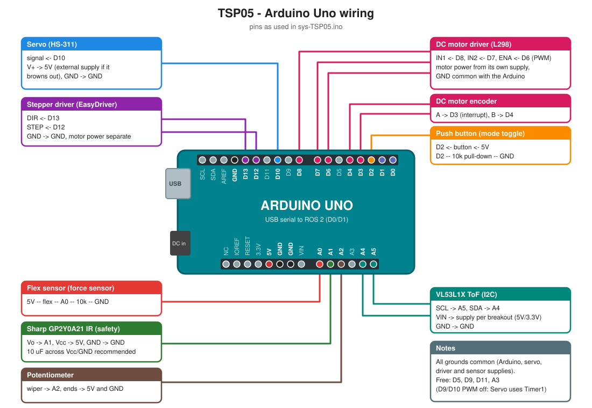

# sys-TSP05: Sensors & Motor Control

An Arduino Uno reads every sensor and drives the motors. A ROS 2 node bridges it over USB serial, and Foxglove is the dashboard.

```
sensors ─┐                    USB serial (JSON, 115200)            WebSocket :8765
         ├─ Arduino Uno ◄──────────────────────────► tsp05_bridge ◄──► foxglove_bridge ◄──► Foxglove
motors ◄─┘  (sys-TSP05.ino)                          (ROS 2 Humble, in the f1tenth container)
```

## Hardware and mapping

This follows the TSP05 demo-flow diagram, adapted to the hardware on the bench:

| Diagram | On the bench | Pin | Sensor mode drives |
|---|---|---|---|
| FSR (force) | Flex sensor as the force sensor (5V–flex–A0–10k–GND) | A0 | **Servo**: force 0–100 % (calibrated straight → fully bent, saved in EEPROM) → 0–180°, with median + EMA filter, 10° deadzone and 5° deadband (from `vamsi/servo-flex-integrated`) |
| Omron slot sensor | Potentiometer | A2 | **Stepper**: 0–100 % → 0–360°, 3° deadband |
| VL53L1X | VL53L1X | I2C (A4/A5) | **DC motor** target speed: ≤10 cm → 0, 10–100 cm → 20–50 RPM (linear) |
| VL53L5CX (safety) | Sharp GP2Y0A21 IR (no VL53L5CX) | A1 | **Safety stop**: obstacle closer than 20 cm stops all motors |
| Hardware button | Push button to 5V, pull-down | 2 | GUI ↔ SENSOR mode toggle (debounced) |
| RC servo | Servo | 10 | |
| Stepper (EasyDriver) | Stepper | STEP 12, DIR 13 | |
| DC motor + encoder | DC motor (L298) with encoder, PI speed control | ENA 6, IN1 8, IN2 7, enc A 3, enc B 4 | |

The DC motor's encoder A must be on an interrupt pin (2 or 3 on the Uno). Pin 2 is the button, so encoder A is on 3 and B on 4. Set `DC_MOTOR_CONNECTED = false` in `sys-TSP05.ino` to run without the motor.

### DC motor notes

- **Measured speed range:** the motor needs about PWM 140 to start, runs at about 20 RPM (PWM 80) to 50 RPM (PWM 160+), and doesn't go much faster. That is why the ToF range maps to 20–50 RPM. Targets under about 20 RPM may stall.
- **Speed control:** feedforward (`PWM = 30 + 1.1·RPM`, from the measured curve) plus PI. From standstill the output ramps up until the motor breaks away. The constants are in `DcMotor.h`.
- **Stall protection:** if it is driven at PWM ≥ 200 and the encoder sees no motion for 1.5 s, the output is cut. The firmware sends a `dc_stall` event and Foxglove shows *STALLED*. A new `DC` command, stopping, or reversing clears it.
- **Polarity:** positive PWM must read as positive RPM, or the speed loop runs away. `scripts/tsp05 dctest` spins the motor, asks if it turned forward, and saves the motor/encoder inversion on the Arduino (EEPROM). It then checks the speed loop at +30, −30 and 0 RPM.

### Modes

- **GUI** (the default at power-on): motors only move on commands from ROS 2 / Foxglove.
- **SENSOR**: motors follow the sensors as in the table above.
- To switch, press the hardware button or publish to `/tsp05/cmd/mode`.
- **Safety:** in both modes, an obstacle in front of the Sharp sensor closer than the threshold, for 2 readings in a row, stops all motors and blocks motor commands. It releases after 0.5 s with no obstacle. A threshold of `0` disables it.

## Pinout



| Arduino pin | Connected to | Notes |
|---|---|---|
| **D0 / D1** | USB serial | ROS 2 link at 115200 baud. Don't use these for anything else. |
| **D2** | Push button (mode toggle) | Button to 5V, 10 kΩ pull-down to GND; pressed = HIGH. |
| **D3** | DC encoder channel A | Interrupt pin; counts rising edges. |
| **D4** | DC encoder channel B | Read on each A edge for the direction. |
| **D6** | DC driver ENA (PWM) | Speed. Motor power from the driver's own supply, GND common. |
| **D7** | DC driver IN2 | Direction. |
| **D8** | DC driver IN1 | Direction. |
| **D10** | Servo signal | Servo V+ to 5V (use an external 5V supply if the board resets when it moves), GND common. |
| **D12** | Stepper driver STEP | EasyDriver. Motor power from its own supply. |
| **D13** | Stepper driver DIR | The on-board LED flickers with the direction; that's normal. |
| **A0** | Flex sensor (force sensor) | Voltage divider: 5V – flex – **A0** – 10 kΩ – GND. |
| **A1** | Sharp GP2Y0A21 IR, Vo | Vcc 5V, GND. A 10 µF capacitor across Vcc/GND is recommended. |
| **A2** | Potentiometer wiper | Outer legs to 5V and GND. |
| **A4 (SDA)** | VL53L1X SDA | I2C. These are the same pins as the SDA/SCL pins next to AREF. |
| **A5 (SCL)** | VL53L1X SCL | Power the breakout as its board requires (most have a regulator and take 5V). |
| 5V / GND | Sensor supplies | All grounds must be common: Arduino, servo supply, stepper driver, sensors. |
| **Free** | D5, D9, D11, A3 | D9 and D10 can't do `analogWrite` PWM (the Servo library uses Timer1). |

The diagram is generated from `docs/make_pinout.py`. Edit it and run `python3 docs/make_pinout.py` if the wiring changes.

## How to test

1. Close the Arduino IDE **Serial Monitor**, because it blocks the port.
2. In a terminal on your laptop (not inside Docker), go to the repo:
   ```bash
   cd ~/sys_eng/sensors_motors/sys-TSP05
   ```
3. **Once:** calibrate the force (flex) sensor. Follow the prompts: hold it straight and press Enter, then bend it fully and press Enter.
   ```bash
   scripts/tsp05 calibrate
   ```
4. Test everything. Follow the prompts; it ends with a PASS/FAIL summary.
   ```bash
   scripts/tsp05 check
   ```

**The servo only follows the flex sensor in SENSOR mode.** Switch with the hardware button, the Foxglove *SENSOR mode* button, or `scripts/tsp05 mode sensor`.

### Foxglove dashboard

```bash
scripts/tsp05 foxglove
```

This starts everything and opens Foxglove. In Foxglove:
1. *Open connection → Foxglove WebSocket → `ws://localhost:8765`*.
2. **First time only:** *Layouts* menu (top left) → *Import from file* → `foxglove/tsp05_layout.json`.

The layout follows the design image:
- **Left:** mode and safety indicators, *GUI mode* / *SENSOR mode* buttons. Tabs hold the motor controls (servo angle, stepper ±15° or any angle, DC speed) and force-sensor calibration buttons. The Arduino's replies are shown below, so you can see when a command was rejected.
- **Middle:** live gauges for force, potentiometer, both distance sensors, servo, stepper, DC target and measured speed, a DC stall light and the button.
- **Right:** force sensor raw vs filtered, flex transfer function (bend angle vs ADC), distances with the safety threshold, motor positions, DC target vs measured speed, and VL53L1X distance → DC speed (XY).

To edit the layout, change `foxglove/make_layout.py` and run it again.

### Other commands

| Command | When |
|---|---|
| `scripts/tsp05 flash` | after changing the Arduino code |
| `scripts/tsp05 watch` | to see all readings live in the terminal (Ctrl+C to stop) |
| `scripts/tsp05 stop` | to free the port for the Arduino IDE |
| `scripts/tsp05 mode sensor` / `mode gui` | switch mode |
| `scripts/tsp05 servo 90` / `step 15` / `dc 30` | move a motor (GUI mode only) |
| `scripts/tsp05 dctest` | DC motor direction + speed-control test (**the motor spins**) |

Everything below is reference detail; you don't need it to test.

---

## Running manually (reference)

### 1. Flash the Arduino

Open `sys-TSP05.ino` in the Arduino IDE (needs the *SparkFun VL53L1X 4m Laser Distance Sensor* library) and upload it to the Uno. **Close the Serial Monitor afterwards**, because only one program can use the port.

### 2. Start the container

```bash
docker/f1_new_terminal.sh        # point the f1_new_terminal alias at this script
```

The script builds the `f1tenth_tsp05` image (`f1tenth_gym_ros` plus `foxglove_bridge` and `pyserial`) and creates or starts the `f1tenth` container. The container gets:
- host networking, so port 8765 reaches the host;
- `/dev` with access to USB serial devices, so the Arduino can be re-plugged;
- X11 and the GPU;
- `~/sim_ws/src` mounted at `/sim_ws/src`, and this repo at `/tsp05`.

To use it from the alias, update `~/.bashrc`:

```bash
alias f1_new_terminal='/home/vamsi/sys_eng/sensors_motors/sys-TSP05/docker/f1_new_terminal.sh'
```

### 3. Build and launch (inside the container)

```bash
source /opt/ros/humble/setup.bash
cd /tsp05/ros2_ws
colcon build --symlink-install
source install/setup.bash
ros2 launch tsp05_bridge tsp05.launch.py
```

Launch arguments:

| Argument | Default | Notes |
|---|---|---|
| `port` | `/dev/ttyACM0` | Arduino serial device |
| `baud` | `115200` | |
| `initial_mode` | `''` | `GUI` or `SENSOR` to set on connect; empty keeps the board's current mode |
| `safety_threshold_cm` | `-1.0` | `<0` keeps the firmware default (20 cm); `0` disables the safety stop |
| `foxglove` | `true` | also start `foxglove_bridge` |
| `foxglove_port` | `8765` | |

### 4. Foxglove

Open Foxglove → *Open connection* → *Foxglove WebSocket* → `ws://localhost:8765`.

Suggested panels (as in section 6 of the diagram):

| Panel | Topic(s) |
|---|---|
| Publish (mode buttons) | `/tsp05/cmd/mode` `std_msgs/String`: `{"data": "GUI"}` / `{"data": "SENSOR"}` / `{"data": "TOGGLE"}` |
| Publish (servo) | `/tsp05/cmd/servo_angle` `std_msgs/Float32`: `{"data": 90}` |
| Publish (stepper) | `/tsp05/cmd/stepper_delta` `std_msgs/Float32`: `{"data": 15}` (relative °) |
| Publish (DC) | `/tsp05/cmd/dc_rpm` `std_msgs/Float32` |
| Indicator | `/tsp05/mode`, `/tsp05/safety/active`, `/tsp05/connected` |
| Plot: flex raw vs filtered | `/tsp05/sensors/flex/adc_raw.data`, `/tsp05/sensors/flex/adc_filtered.data` |
| Plot: distances | `/tsp05/sensors/tof/distance_cm.data`, `/tsp05/sensors/sharp/distance_cm.data` |
| Gauge | `/tsp05/sensors/flex/angle_deg`, `/tsp05/sensors/pot/angle_deg`, `/tsp05/motors/servo/angle_deg`, `/tsp05/motors/stepper/angle_deg` |
| Raw Messages | `/tsp05/events` (acks, mode changes, safety stops), `/tsp05/state_json` |

## ROS 2 interface (`tsp05_bridge`)

All topics are under `/tsp05` and use `std_msgs`. Invalid distances are published as NaN; check `.../ok` and `.../valid` for whether a value is usable.

**Published**

| Topic | Type | |
|---|---|---|
| `mode` | String | `GUI` / `SENSOR` |
| `connected` | Bool | receiving data from the Arduino |
| `safety/active`, `safety/threshold_cm` | Bool, Float32 | |
| `sensors/flex/{adc_raw, adc_filtered, resistance_kohm, force_pct, bend_deg, cal_flat_kohm, cal_bent_kohm}` | Float32 | |
| `sensors/flex/transfer` | geometry_msgs/Point | x = bend angle deg, y = filtered ADC, z = resistance kOhm (for the transfer function XY plot) |
| `sensors/pot/{adc_raw, voltage, position_pct, angle_deg}` | Float32 | |
| `sensors/flex/angle_deg` | Float32 | bend angle from resistance (protocol.py model) |
| `sensors/tof/ok`, `sensors/tof/distance_cm` | Bool, Float32 | VL53L1X |
| `sensors/sharp/{voltage, distance_cm}`, `valid`, `status` | Float32, Bool, String | |
| `button/pressed`, `button/count` | Bool, Int32 | |
| `motors/servo/angle_deg`, `motors/stepper/{angle_deg, target_deg}` | Float32 | |
| `motors/dc/{connected, target_rpm, rpm, pwm}` | Bool, Float32 | |
| `motors/dc/polarity`, `motors/dc/stalled` | Int32, Bool | polarity bit0 = motor inverted, bit1 = encoder inverted |
| `motors/dc/transfer` | geometry_msgs/Point | x = VL53L1X cm, y = target RPM, z = measured RPM (for the XY plot) |
| `events` | String | JSON acks / events from the Arduino |
| `state_json` | String | full state line (10 Hz) |

**Subscribed** (commands)

| Topic | Type | |
|---|---|---|
| `cmd/mode` | String | `GUI`, `SENSOR`, `TOGGLE` |
| `cmd/servo_angle` | Float32 | 0–180°, GUI mode only |
| `cmd/stepper_delta` | Float32 | relative degrees, GUI mode only |
| `cmd/dc_rpm` | Float32 | −100…100, GUI mode only |
| `cmd/dc_pwm` | Float32 | open-loop test PWM −230…230, GUI mode only, stops after 2 s |
| `cmd/dc_polarity` | String | `"<motor 0/1> <encoder 0/1>"`, saved on the Arduino |
| `cmd/safety_threshold` | Float32 | cm, `0` disables |
| `cmd/flex_calibrate` | String | `FLAT`, `BENT`, `RESET` |

Commands sent in the wrong mode, or while the safety stop is active, are rejected. The reason appears on `/tsp05/events` and in the node log.

## Serial protocol

The Arduino sends one JSON object per line, with `"t"` set to `boot`, `state` (10 Hz), `ack` or `event`. The host sends text commands:
`MODE GUI|SENSOR|TOGGLE`, `SERVO <deg>`, `DC <rpm>`, `STEP <deg>`, `SAFETY <cm>`, `CAL FLAT|BENT|RESET`, `DCPWM <pwm>`, `DCPOL <m> <e>`.
The parser and command formatting are in `ros2_ws/src/tsp05_bridge/tsp05_bridge/protocol.py`.

Protocol unit tests (no ROS or hardware needed):

```bash
cd ros2_ws/src/tsp05_bridge && python3 -m pytest test
```
