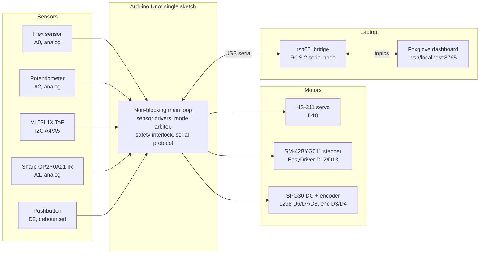

# TSP05: Sensors & Motor Control

One Arduino Uno sketch reads four sensors and drives three motors (RC servo, stepper, encoder DC motor). A ROS 2 Humble bridge on the laptop talks to the Uno over USB serial, and a Foxglove dashboard shows sensor and motor state and sends motor commands.

The final demo code is in [`sys-TSP05-latest/`](sys-TSP05-latest/); the sketch is [`sys-TSP05-fixed.ino`](sys-TSP05-latest/sys-TSP05-fixed.ino). The earlier per-device prototypes and intermediate firmware were removed from the tree in the final cleanup and remain visible in the commit history. Detailed run instructions, the rubric checklist and fix notes are in:

- [`sys-TSP05-latest/README.md`](sys-TSP05-latest/README.md): quick start, ROS topics, CLI commands
- [`sys-TSP05-latest/NATIVE_HUMBLE.md`](sys-TSP05-latest/NATIVE_HUMBLE.md): native Ubuntu 22.04 / ROS 2 Humble setup
- [`sys-TSP05-latest/RUBRIC_CHECKLIST.md`](sys-TSP05-latest/RUBRIC_CHECKLIST.md): one-by-one demonstration checklist
- [`sys-TSP05-latest/calibration/README.md`](sys-TSP05-latest/calibration/README.md): sensor measurement and transfer-function workflow
- [`sys-TSP05-latest/FIXES_2026-11-11.md`](sys-TSP05-latest/FIXES_2026-11-11.md): final round of fixes against the rubric
- [`sys-TSP05-latest/FLEX_POT_MAPPING_UPDATE.md`](sys-TSP05-latest/FLEX_POT_MAPPING_UPDATE.md): sensor-to-motor mapping details

---

## Repository layout

Everything below is inside `sys-TSP05-latest/`.

| Path | Contents |
|---|---|
| `sys-TSP05-fixed.ino` | Main sketch: serial protocol, GUI/SENSOR mode arbiter, safety interlock, EEPROM calibration |
| `DcMotor`, `StepperMotor`, `FlexSensor`, `Potentiometer`, `DistanceSensor`, `SharpIRSensor`, `Button` (`.h`/`.cpp`) | One non-blocking driver class per device |
| `SensorMapping.h` | Flex → servo and pot → stepper mapping, servo deadband and hysteresis |
| `ros2_ws/src/tsp05_bridge/` | ROS 2 package: `serial_node.py`, `protocol.py`, `cli.py`, launch file, protocol tests |
| `scripts/tsp05` | Launcher for building, flashing, starting the bridge and sending commands |
| `foxglove/` | Dashboard layout (`tsp05_layout.json`) and its generator (`make_layout.py`) |
| `tools/` | Host-side syntax check, simulated control tests, `sensor_validation.py` |
| `calibration/` | Measurement workflow and the recorded Sharp IR points |
| `docs/` | Pinout diagram and its generator |

## Quick start

On Ubuntu 22.04 with ROS 2 Humble and Arduino CLI installed (see `NATIVE_HUMBLE.md`):

```bash
cd sys-TSP05-latest
export TSP05_PORT=/dev/ttyACM0
scripts/tsp05 unit        # protocol and validation tests, no hardware
scripts/tsp05 flash       # compile and upload to the Uno
scripts/tsp05 build       # colcon build of tsp05_bridge
scripts/tsp05 foxglove    # start the bridge, then connect Foxglove to ws://localhost:8765
scripts/tsp05 check       # guided live hardware tests
```

Motor and calibration commands use the same launcher: `mode gui|sensor`, `servo <deg>`, `step <±deg>`, `dc <±rpm>`, `dcpos <±deg>`, `dctest`, `safety <cm>`, `calibrate` (flex endpoints) and `potcal` (pot endpoints).

---

## System overview



The pinout diagram is at [`sys-TSP05-latest/docs/pinout.svg`](sys-TSP05-latest/docs/pinout.svg).

### Sensor to motor mapping (SENSOR mode)

| Sensor | Type | Physical output | Controls |
|---|---|---|---|
| Flex sensor (A0) | Analog, voltage divider with 10 kΩ | Bend angle (deg), calibrated straight/bent endpoints and maximum bend angle in EEPROM (defaults 13 kΩ / 34 kΩ) | Servo, 0–180° |
| Potentiometer (A2) | Analog | Shaft angle (deg), calibrated ADC endpoints in EEPROM | Stepper, absolute 0–360°, with a 3° deadband. Stepper zero is its position at boot |
| VL53L1X ToF (I2C) | Digital | Distance (cm) | DC motor speed: stop at or below 10 cm, then 20–50 RPM linearly from 10 to 100 cm, 50 RPM beyond. Stops if the sensor reports an error |
| Sharp GP2Y0A21 IR (A1) | Analog | Distance (cm), 10–80 cm, from a power-law fit of the output voltage | Safety interlock: stops all motors after 2 consecutive readings closer than the threshold (default 20 cm, adjustable, 0 disables) and releases after 500 ms clear |
| Pushbutton (D2) | Digital, not counted as a sensor | Debounced press count | Toggles GUI ↔ SENSOR mode |

In **GUI mode** the Foxglove panels command servo absolute angle, stepper relative angle (±deg, rounded to the nearest microstep, and the actual angle moved is reported back), DC signed RPM and DC relative position (±deg). An open-loop DC PWM test (auto-stops after 2 s) and a stored DC polarity setting are also available for bring-up. In **SENSOR mode** GUI motor commands are rejected and acknowledged as such on `/tsp05/events`. The mode can be switched from the debounced button or the GUI mode buttons. The sketch boots in GUI mode, and GUI motor commands are also rejected while the safety stop is active.

### Filtering

- **Flex:** sampled every 20 ms, 5-sample median followed by an EMA (α = 0.15). Foxglove plots raw ADC next to filtered ADC (`/tsp05/sensors/flex/adc_raw` vs `adc_filtered`).
- **Potentiometer:** 10-sample moving average, updated every 100 ms.
- **Sharp IR:** median of 25 ADC reads every 50 ms, then an EMA on distance (α = 0.35), plus spike rejection. A jump of more than 12 cm is ignored unless 3 consecutive readings agree within 8 cm.
- **Servo command deadband:** evaluated every 60 ms with an 8° deadband, two agreeing samples in a row, 180 ms minimum between writes and hysteresis at 0° and 180°, so a stationary flex sensor does not make the servo chatter.
- **DC speed target:** in SENSOR mode the ToF-derived target only updates when it changes by 2 RPM or more, so ToF noise does not keep resetting the speed loop.

### DC motor control

- **Speed loop:** encoder RPM is sampled every 200 ms (210 pulses per output revolution assumed). The output is a feedforward `pwm = sign·(30 + 1.1·|rpm|)` plus PID on the RPM error (Kp 1.0, Ki 1.5, Kd 0.02, derivative on the measurement), capped at 230 PWM.
- **Position loop:** a relative move requests a speed proportional to the remaining angle (0.45 RPM per degree, between 8 and 35 RPM) in the original direction only. Arrival is checked every loop iteration, and the move latches complete once the encoder is within 3° of the target.
- **Breakaway and stall:** while the encoder shows no motion the PWM ramps up 15 counts per sample. If PWM stays at 200 or more for 1.5 s with no motion, the output is cut and `/tsp05/motors/dc/stalled` is set.

---

## Challenges

### 1. The DC motor kept stalling at random, even when powered directly from the bench supply

This took most of our debugging time and we did not fully solve it.

**Symptom.** The SPG30 gear motor ran, but it would stop at random moments and stay stopped while still drawing **several amps**. When it was running, we measured its PWM-to-RPM curve and fitted the feedforward to it: about PWM 65 for 30 RPM, saturating near 115 RPM (see `7a51f65`). After a stall it often would not start again by itself. Forcing the rotor around with **pliers** sometimes got it running again, but not reliably, and it would stall again later.

At first we suspected our control code: PWM too low to overcome friction (the handout warns about the deadband), the PI integrator winding up, wrong L298 wiring, or a bad encoder sign. Then we took the controller out entirely and connected the motor **straight to the bench power supply**. It behaved the same way: it ran for a while, then stopped and drew high current.

**What we tried:**
- **Bypassing the electronics.** Connecting directly to the supply rules out the Arduino, the L298, the PWM frequency, our feedforward and PI code, and the wiring between them. A healthy DC motor across a supply at its rated voltage does not stop at random.
- **Forcing the rotor.** Turning the shaft with pliers while powered sometimes got it spinning again. That tells us the stall depends on the rotor's angle or on something mechanical that a push can break free.
- **Swapping motors.** We tried several motors and saw the same behaviour, so it was not a single bad unit.
- **Removing the gearbox.** We took the gearbox off to check whether the gear train was jamming. The bare motor still stalled, so the gearbox is not the main cause.

**Analysis.** A DC motor draws its largest current when the rotor is not turning, because there is no back-EMF to oppose the supply voltage (I = V/R). A motor drawing amps while stopped is electrically in a stall. Either the rotor is mechanically held, or the current flows through a path that produces little torque. Three observations point to the motor itself, not our control: the motor ran sometimes, it stopped even without our electronics, and a mechanical push could restart it. Likely causes:
- **Binding at certain rotor positions:** a worn or dry bushing, debris in the air gap, or a loose magnet rubbing the armature at some angles. The rotor runs until it reaches the tight spot and then sticks, and the pliers free it. This matches our impression that something inside was seizing up.
- **Shorted commutator segments or winding:** if the brushes stop on a pair of shorted segments, current goes through the short and produces almost no torque, so the motor sits there drawing amps. Nudging the rotor moves the brushes off the bad segments, which matches the pliers sometimes working. Brush wear or carbon dust between segments can cause this.
- **A short through the encoder board:** on the SPG30 the encoder PCB is soldered across the back of the motor next to the motor terminals. A marginal solder bridge or damaged board could load the supply. This explains the high current, but explains the angle-dependent stalls less well.

Several kit motors behaved the same way, so these units may have been worn or damaged before (for example run at stall or over voltage in earlier semesters) instead of all failing independently.

**What we would do next / suggested fixes:**
1. With the motor disconnected, **turn the bare shaft slowly through a full revolution by hand** and feel for a tight spot. Mark where it binds and check whether it stalls at the same angle when powered.
2. **Measure terminal resistance while rotating the shaft by hand** in small steps. A position where resistance drops sharply points to shorted commutator segments. Compare against a known good motor.
3. **Disconnect or inspect the encoder board** and repeat the direct-supply test to rule out a short through it.
4. Open the motor if allowed: **clean the commutator and check brush wear**, and look for debris or a loose magnet.
5. Set a **current limit on the bench supply** for every motor test. This protects the motor from overheating while stalled, and overheating makes the damage worse.
6. Ask the TAs for a motor from a different batch and check it with steps 1–3 before connecting it to our circuit.

**Effect on the project.** When the motor ran, the closed-loop speed control behaved as designed. The random stalls made it unreliable to tune and demonstrate, especially the position control and the anti-hunt latch. We also tested that logic with the host-side simulations in `tools/tests/`. The stalls shaped the firmware in two ways:
- a **breakaway ramp:** while the encoder shows no motion, the PWM ramps up 15 counts per sample to push through a sticking point
- **stall detection:** if PWM stays ≥ 200 for 1.5 s with no encoder pulses, the output is cut, so a seized motor is not driven at high current indefinitely, and the GUI shows a STALLED indicator

### 2. Servo library vs. PWM pins

On the Uno, the `Servo` library uses Timer1, which disables hardware PWM on D9 and D10. With the servo on D10, the L298 enable pin had to go on a pin driven by a different timer (D6, Timer0). We checked this against the handout before wiring, which saved us from a confusing "PWM does nothing" bug.

### 3. Sharp IR noise falsely tripping the safety interlock

The raw Sharp distance had occasional large spikes, for example when a target edge or a reflective surface passed through the beam. Because the Sharp drives the safety stop, a single spike could stop every motor. A median filter alone was not enough because the spikes sometimes lasted more than one sample. We added an EMA on distance and a step-confirmation rule: jumps larger than 12 cm are accepted only after 3 consecutive readings agree within 8 cm. This rejects spikes but still reacts to a real object within about 150 ms. The trade-off is slightly slower safety response, which is acceptable for a lab demo but would not be for a real e-stop.

### 4. DC position control hunting around the target

The first position loop checked arrival only once per 200 ms RPM sample and enforced a 20 RPM minimum near the target. The motor overshot, the controller reversed, overshot again and oscillated. We now check arrival every loop iteration, stop PWM as soon as the encoder enters the ±3° band, latch completion so it never commands a reverse correction, and lowered the minimum approach speed to 8 RPM. With the L298 at 0 PWM the motor coasts instead of braking, so some overshoot from inertia remains. Active braking (both IN pins high) would reduce it.

### 5. Servo chatter from a stationary flex sensor

Even after filtering, small fluctuations in the flex reading caused the servo to twitch when the sensor was held still. We added an 8° command deadband, required two consecutive samples in the same direction before moving, and rate-limited servo writes to one every 180 ms. Hysteresis at 0° and 180° keeps the servo from jittering at the end stops. Some remaining twitch came from servo supply noise, which software cannot fix. A separate regulated 5–6 V supply with a common ground made the biggest difference.

---

## Using these sensors and motors in our project

*(Covered live in the presentation.)* The ToF and Sharp IR sensors are suited to obstacle and proximity detection and to safety interlocks. The flex sensor and potentiometer work as joint-angle feedback or user input devices. The architecture (one non-blocking microcontroller loop, a serial bridge to ROS 2, mode arbitration between operator and autonomous control, and a sensor-driven safety stop) carries over directly to the project's motion subsystems.
